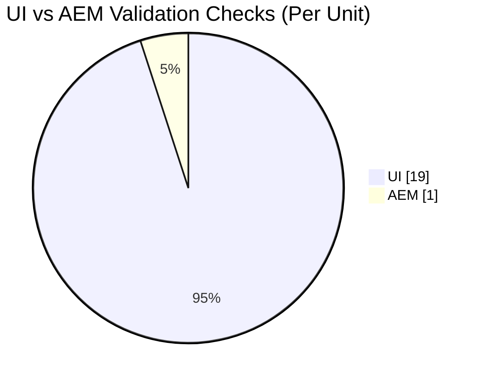
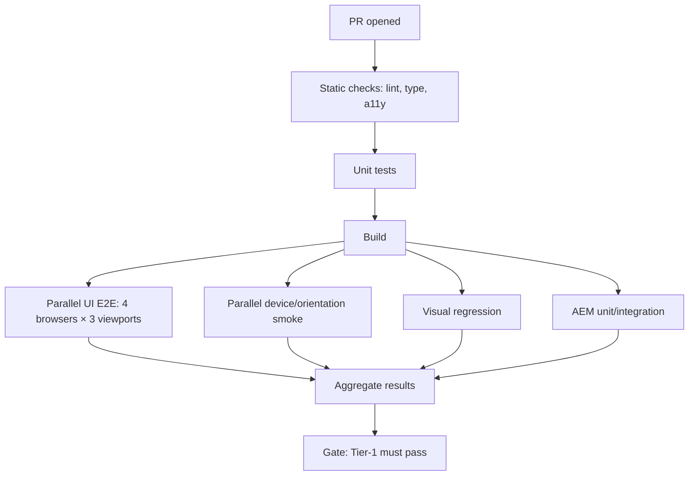
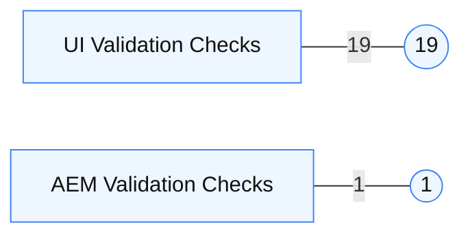
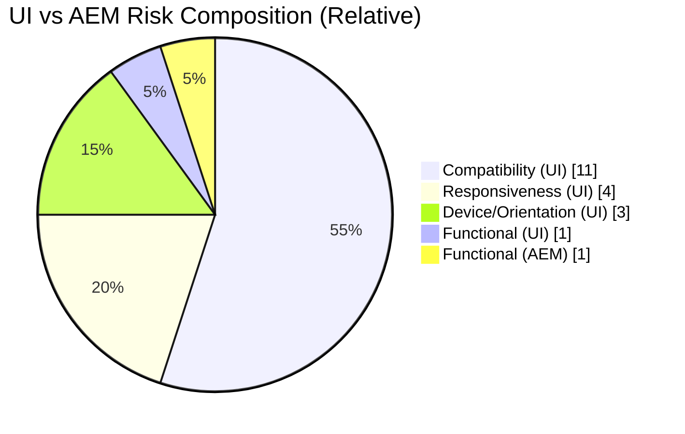

## UI vs AEM Delivery Complexity Analysis

**Executive summary**: One UI code unit must pass validation across 19 distinct execution/validation contexts, while one AEM (JVM) code unit is validated in a single execution environment. This makes UI delivery scope, stabilization effort, and verification coverage roughly 19× that of AEM unless mitigated by automation and standards.

---

### Scope and premise
- **UI delivery scope**: 4 browsers × 3 viewports (desktop, tablet, mobile) = 12; 3 devices × 2 orientations (portrait, landscape) = 6; plus 1 logical/functional check. **Total: 19 checks** per UI unit.
- **AEM delivery scope**: 1 logical/functional check of code in one JVM execution environment. **Total: 1 check** per AEM unit.
- **Relative complexity**: UI ≈ **19×** AEM by validation breadth.

> The 19× reflects validation breadth, not inherent code difficulty. Effort is also influenced by accessibility, localization, performance, analytics, code churn, and test maturity.

---

### Visuals

#### 1) Validation breadth comparison


#### 2) UI execution coverage map
```mermaid
flowchart LR
  subgraph Browsers (4)
    CH[Chrome]
    FF[Firefox]
    SF[Safari]
    ED[Edge]
  end
  subgraph Viewports (3)
    VP1[Desktop]
    VP2[Tablet]
    VP3[Mobile]
  end
  subgraph Devices × Orientation (3 × 2)
    P1[Phone • Portrait]
    L1[Phone • Landscape]
    P2[Tablet • Portrait]
    L2[Tablet • Landscape]
    P3[Laptop • Portrait]
    L3[Laptop • Landscape]
  end
  classDef dim fill:#f8fafc,stroke:#94a3b8,color:#0f172a
  class CH,FF,SF,ED,VP1,VP2,VP3,P1,L1,P2,L2,P3,L3 dim
```

#### 3) Example CI pipeline to manage complexity


---

### Summary table of validation breadth

| Area | Elements | Count |
|---|---|---:|
| Browsers | Chrome, Firefox, Safari, Edge | 4 |
| Viewports | Desktop, Tablet, Mobile | 3 |
| Device × Orientation | 3 devices × 2 orientations | 6 |
| Logical/Functional | Code correctness | 1 |
| **Total (UI)** | 4 + 3 + 6 + 1 | **19** |
| **Total (AEM)** | JVM execution environment | **1** |

---

### Implications for planning
- **Test effort**: UI requires broad cross-environment regression; AEM focuses on JVM/unit/integration and API contracts.
- **Defect probability**: UI variability drives more edge cases; without automation, escape rates rise.
- **Cycle time**: UI stabilization extends due to environment-specific fixes; AEM cycle time is more predictable.
- **Resource mix**: UI benefits from accessibility, cross-browser, and visual QA specialization.

---

### Recommended mitigations
- **Automation**
  - Playwright/Cypress + cloud grid to parallelize 12+ UI checks per PR.
  - Visual regression for key viewports (e.g., Percy, Loki, Playwright snapshots).
  - Contract tests for AEM APIs to decouple UI/backend release cadence.
- **Standards & design system**
  - Responsive component library with tokens and layout primitives.
  - Accessibility (WCAG 2.2 AA) enforced in CI (axe-core).
- **Release hygiene**
  - Feature flags/canaries for UI; dark launches for AEM.
  - Observability: RUM for UI (Core Web Vitals by browser/viewport), APM for AEM.
- **Environment policy**
  - Tiered support matrix: Tier-1 (must pass), Tier-2 (best effort), Deprecated.

---

### Sample support matrix (proposed)
- **Tier-1**: Chrome (latest-1), Safari (latest), Firefox (latest), Edge (latest)
- **Viewports**: Desktop (≥1280px), Tablet (768–1024px), Mobile (360–430px)
- **Devices/Orientation**: Phone/Tablet both orientations; desktop landscape
- **Accessibility**: WCAG 2.2 AA, keyboard-only, NVDA/VoiceOver smoke

---

### Effort and timeline guidance
- **Baseline multiplier**: UI stories ~2–3× engineering effort vs comparable AEM; ~3–5× QA time without strong automation.
- **Throughput**: Invest in automation first; target ≥80% of UI scenarios covered by parallelized E2E + visual tests.
- **Definition of Done (UI)**: 19-context validation, a11y checks pass, visual diffs stable, perf budgets met.
- **Definition of Done (AEM)**: Unit/integration green on JVM, API contracts verified, perf budgets met.

---

Prepared for: Management Review  
Owner: Engineering  
Date: 2025-08-29

## UI vs AEM Delivery Complexity Analysis

**Executive summary**: One UI code unit must pass validation across 19 distinct execution/validation contexts, while one AEM (JVM) code unit is validated in a single execution environment. This makes UI delivery scope, stabilization effort, and verification coverage roughly 19× that of AEM unless mitigated by automation and standards.

---

### Scope and premise
- **UI delivery scope**: 4 browsers × 3 viewports (desktop, tablet, mobile) = 12; 3 devices × 2 orientations (portrait, landscape) = 6; plus 1 logical/functional check. **Total: 19 checks** per UI unit.
- **AEM delivery scope**: 1 logical/functional check of code in one JVM execution environment. **Total: 1 check** per AEM unit.
- **Relative complexity**: UI ≈ **19×** AEM by validation breadth.

> The 19× reflects validation breadth, not inherent code difficulty. Effort is also influenced by accessibility, localization, performance, analytics, code churn, and test maturity.

---

### Visuals

#### 1) Validation breadth comparison (bar chart)


#### 2) UI execution coverage map
```mermaid
flowchart LR
  subgraph Browsers (4)
    CH[Chrome]
    FF[Firefox]
    SF[Safari]
    ED[Edge]
  end
  subgraph Viewports (3)
    VP1[Desktop]
    VP2[Tablet]
    VP3[Mobile]
  end
  subgraph Devices × Orientation (3 × 2)
    P1[Phone • Portrait]
    L1[Phone • Landscape]
    P2[Tablet • Portrait]
    L2[Tablet • Landscape]
    P3[Laptop • Portrait]
    L3[Laptop • Landscape]
  end
  classDef dim fill:#f8fafc,stroke:#94a3b8,color:#0f172a
  class CH,FF,SF,ED,VP1,VP2,VP3,P1,L1,P2,L2,P3,L3 dim
```

#### 3) Delivery risk composition (stacked comparison)


---

### Implications for planning
- **Test effort**: UI requires broad cross-environment regression; AEM focuses on JVM/unit/integration and API contracts.
- **Defect probability**: UI variability drives more edge cases; without automation, escape rates rise.
- **Cycle time**: UI stabilization extends due to environment-specific fixes; AEM cycle time is more predictable.
- **Resource mix**: UI benefits from accessibility, cross-browser, and visual QA specialization.

---

### Recommended mitigations
- **Automation**
  - Playwright/Cypress + cloud grid to parallelize 12+ UI checks per PR.
  - Visual regression for key viewports (e.g., Percy, Loki, Playwright snapshots).
  - Contract tests for AEM APIs to decouple UI/backend release cadence.
- **Standards & design system**
  - Responsive component library with tokens and layout primitives.
  - Accessibility (WCAG 2.2 AA) enforced in CI (axe-core).
- **Release hygiene**
  - Feature flags/canaries for UI; dark launches for AEM.
  - Observability: RUM for UI (Core Web Vitals by browser/viewport), APM for AEM.
- **Environment policy**
  - Tiered support matrix: Tier-1 (must pass), Tier-2 (best effort), Deprecated.

---

### Sample support matrix (proposed)
- **Tier-1**: Chrome (latest-1), Safari (latest), Firefox (latest), Edge (latest)
- **Viewports**: Desktop (≥1280px), Tablet (768–1024px), Mobile (360–430px)
- **Devices/Orientation**: Phone/Tablet both orientations; desktop landscape
- **Accessibility**: WCAG 2.2 AA, keyboard-only, NVDA/VoiceOver smoke

---

### Effort and timeline guidance
- **Baseline multiplier**: UI stories ~2–3× engineering effort vs comparable AEM; ~3–5× QA time without strong automation.
- **Throughput**: Invest in automation first; target ≥80% of UI scenarios covered by parallelized E2E + visual tests.
- **Definition of Done (UI)**: 19-context validation, a11y checks pass, visual diffs stable, perf budgets met.
- **Definition of Done (AEM)**: Unit/integration green on JVM, API contracts verified, perf budgets met.

---

### Appendix: Example CI pipeline (high level)


Prepared for: Management Review
Owner: Engineering
Date: 2025-08-29
